<div align="center">


# DriveAtlas

**Know every drive you own, and every file on it, even when the drive is in a drawer.**

A lightweight, private catalog for USB sticks, SD cards, HDDs, SSDs and NVMe drives.
Use it on your Android phone alone, on your Windows PC, or both kept in sync. No cloud, no hosting, no subscription.


[Features](#features) · [Getting started](#getting-started) · [Roadmap](#roadmap) · [License](LICENSE.md)

</div>

<br>

<picture>
  <source media="(prefers-color-scheme: dark)" srcset=".github/readme/07-pc-home-dark.png">
  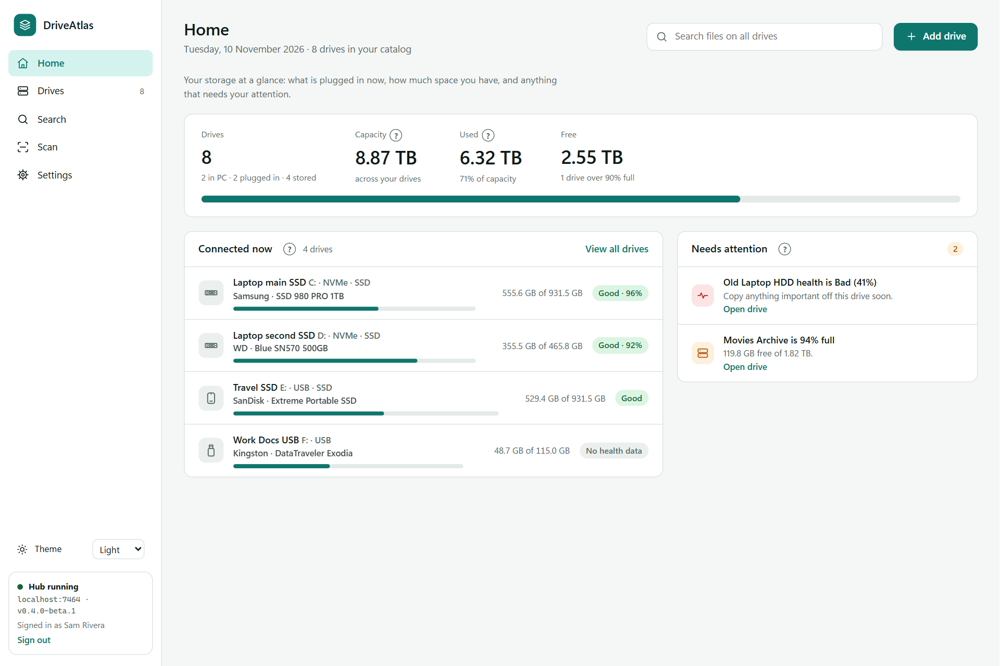
</picture>

<p align="center"><sub>The Windows app. It follows your system theme; GitHub shows the dark version if your GitHub theme is dark.</sub></p>

## Why DriveAtlas

If you own a drawer full of drives, you know the problem: *which one has the 2019 wedding videos? Is that old laptop HDD still healthy? Did I lend the T7 to someone?*

DriveAtlas keeps one catalog of every storage device you own. Plug a drive in once, let it scan, and from then on you can search its files, check its health and find where you keep it, even when it is not plugged in.

- **Search across every drive**, plugged in or not. Results tell you which drive and which shelf.
- **Only names are stored.** File names, folders, sizes and dates. File contents are never copied.
- **Your data stays with you.** It lives on your PC and your phone, synced over your own Wi-Fi.
- **Light on your machine.** Uses the Node.js and Edge you already have. No Electron, no database server.

## Features

<table>
<tr>
<td width="50%" valign="top">

**Catalog every drive**
- 15 drive types: USB, SD, microSD, CFexpress, HDD 3.5"/2.5", external HDD, SATA, mSATA, M.2 SATA, M.2 NVMe, U.2, portable SSD, enclosures, and Other with your own label
- Your own names, advertised vs usable capacity, interface, speeds, serial
- Status: In PC, Plugged in, Stored, Lent out, Retired
- Collections, tags, locations (shelf, box, drawer)

**Map every file**
- Scan the full folder tree of any drive
- Photo and video details (resolution, duration, date taken)
- Quick fingerprints to spot the same file on different drives
- Browse a drive's folders even when it sits in a drawer

**Know drive health**
- Health %, temperature, power-on hours, bad sectors (HDD, SSD, NVMe)
- Uses Windows' own data plus the free `smartctl` (installed with one click)
- Health history chart and early warnings

</td>
<td width="50%" valign="top">

**Smart when you plug in**
- Recognises known drives instantly
- Fills in details for new drives automatically
- Detects changes (partitions, Windows removed, now external) and asks before updating
- Partition map, file systems, BitLocker, bootable USB detection (Windows installer, Ventoy, Linux live, Hiren's)

**Organize and insights** <sub>(Phase 3)</sub>
- QR labels: A4 sticker sheet, label printer, or one label on screen
- Reminders: power on cold-storage drives, health checks, lent drives
- Duplicate finder, scan history with changes, storage charts

**Yours, everywhere**
- Android app that works on its own, no PC needed: its own catalog, and it records the phone’s storage, SD card and any USB drive or SSD plugged in through OTG <sub>(Phase 2)</sub>
- Or use phone and PC together: one account, both keep the whole catalog, and they sync both ways on your Wi-Fi without draining the battery <sub>(Phase 2)</sub>
- Your phones show up on the PC too, with their storage and file lists <sub>(Phase 2)</sub>
- Helper mode: other Windows PCs join your catalog and scan the drives plugged into them <sub>(Phase 2)</sub>
- One backup file restores everything on a new laptop
- Dark and light mode on both apps
- Built-in help: a short introduction on first run, a line on every screen saying what it is for, and (?) tips that explain terms like partitions, S.M.A.R.T. or fingerprints

</td>
</tr>
</table>

## Screenshots

### Windows

<table>
<tr>
<td colspan="2"><picture><source media="(prefers-color-scheme: dark)" srcset=".github/readme/27-pc-welcome-dark.png">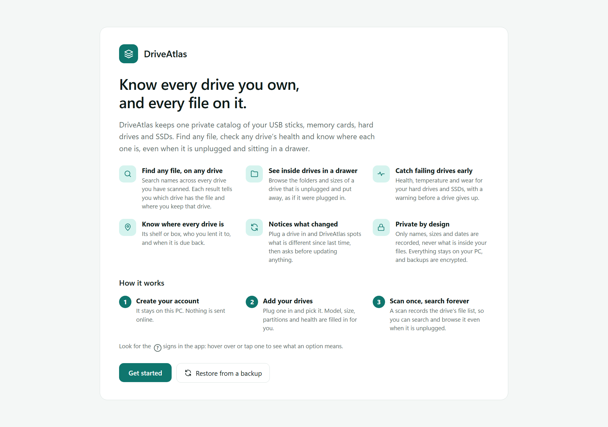</picture><p align="center"><sub>First run: what DriveAtlas does, in plain words</sub></p></td>
</tr>
<tr>
<td width="50%"><picture><source media="(prefers-color-scheme: dark)" srcset=".github/readme/08-pc-drives-dark.png">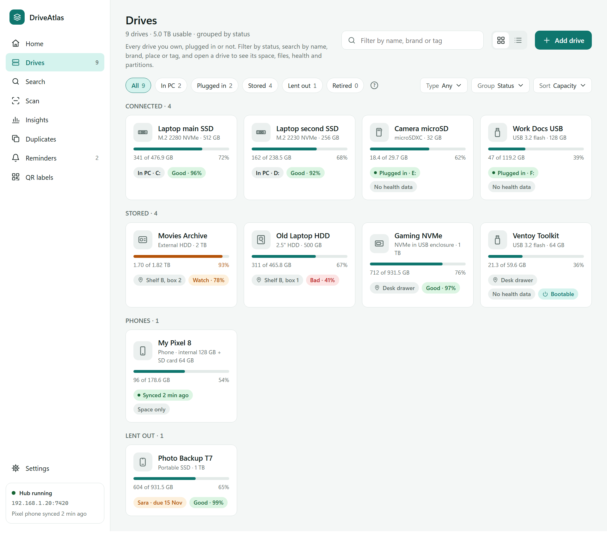</picture><p align="center"><sub>Drives, grouped by status</sub></p></td>
<td width="50%"><picture><source media="(prefers-color-scheme: dark)" srcset=".github/readme/09-pc-drive-detail-dark.png">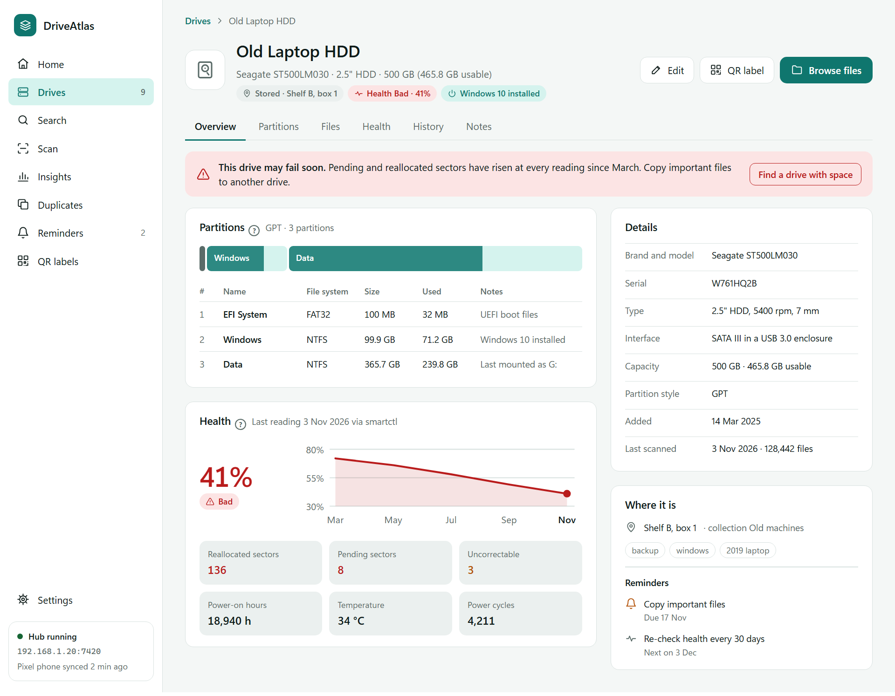</picture><p align="center"><sub>Drive detail: partitions and health</sub></p></td>
</tr>
<tr>
<td width="50%"><picture><source media="(prefers-color-scheme: dark)" srcset=".github/readme/10-pc-search-dark.png">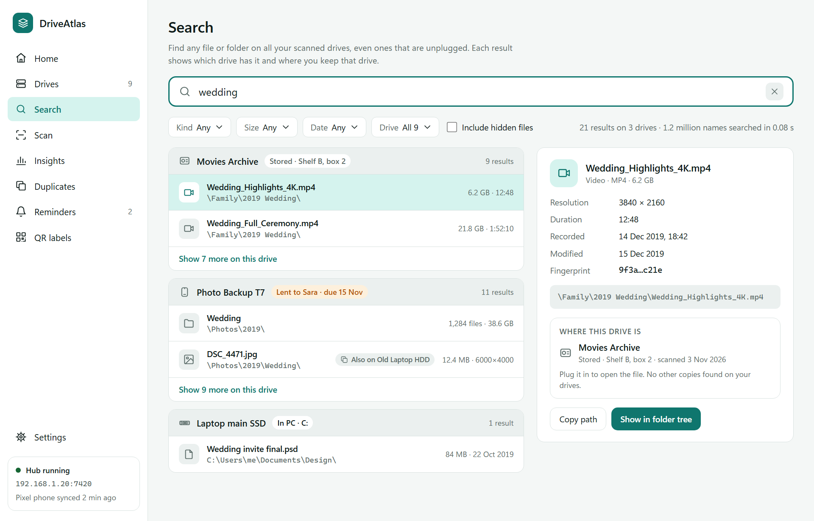</picture><p align="center"><sub>Search across all drives</sub></p></td>
<td width="50%"><picture><source media="(prefers-color-scheme: dark)" srcset=".github/readme/12-pc-scan-dark.png">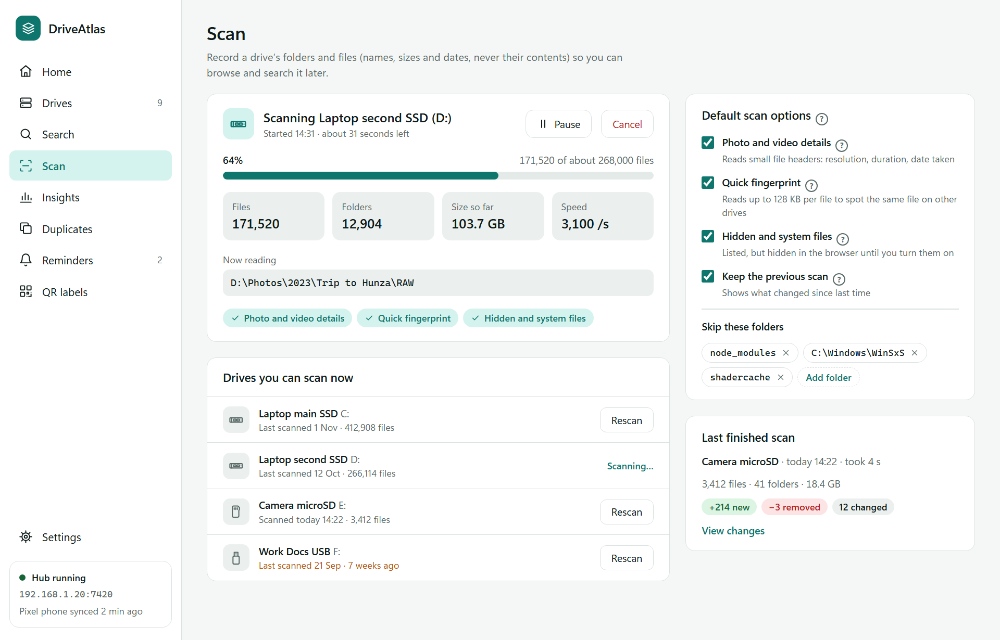</picture><p align="center"><sub>Scanning a drive</sub></p></td>
</tr>
</table>

### Android

<table>
<tr>
<td width="20%"><picture><source media="(prefers-color-scheme: dark)" srcset=".github/readme/29-phone-welcome-dark.png">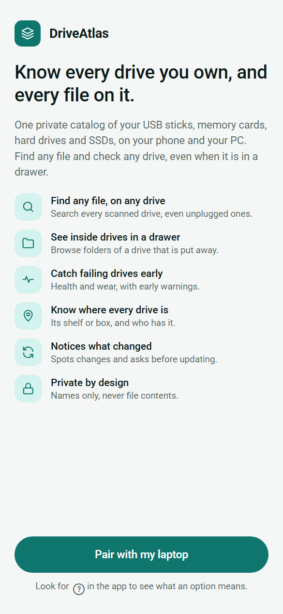</picture><p align="center"><sub>Welcome</sub></p></td>
<td width="20%"><picture><source media="(prefers-color-scheme: dark)" srcset=".github/readme/19-phone-home-dark.png">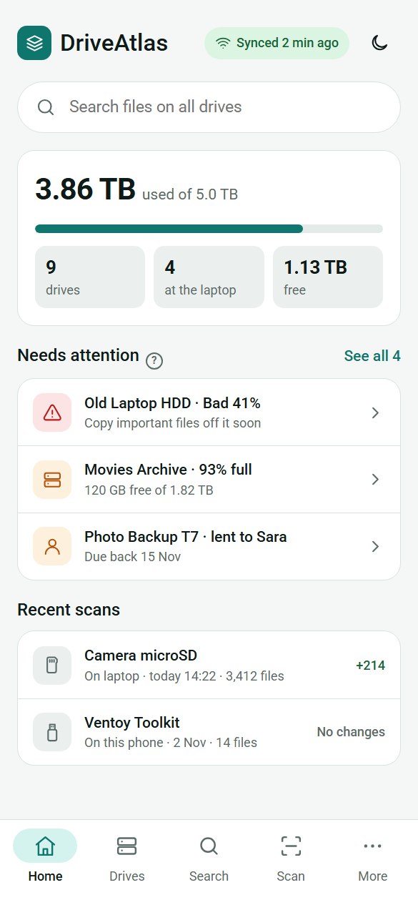</picture><p align="center"><sub>Home</sub></p></td>
<td width="20%"><picture><source media="(prefers-color-scheme: dark)" srcset=".github/readme/20-phone-drives-dark.png">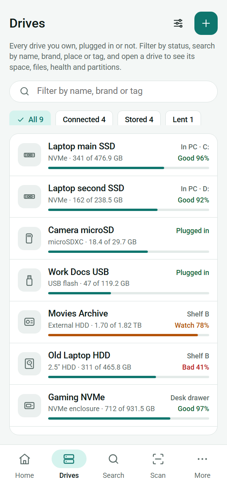</picture><p align="center"><sub>Drives</sub></p></td>
<td width="20%"><picture><source media="(prefers-color-scheme: dark)" srcset=".github/readme/21-phone-drive-detail-dark.png">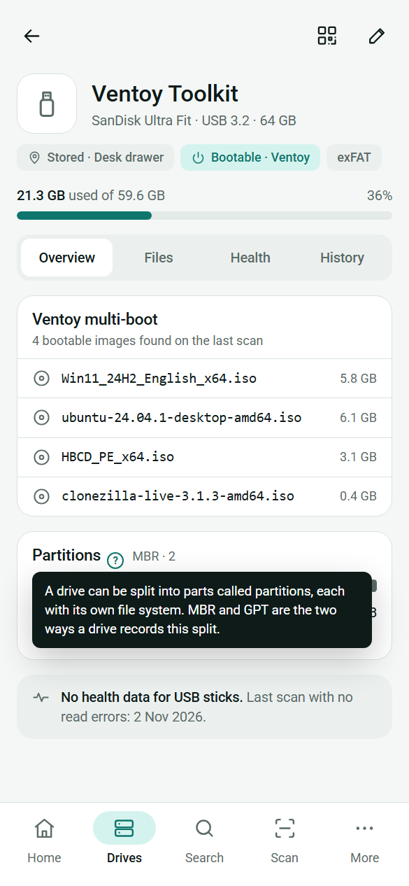</picture><p align="center"><sub>Bootable USB</sub></p></td>
<td width="20%"><picture><source media="(prefers-color-scheme: dark)" srcset=".github/readme/33-phone-this-phone-dark.png">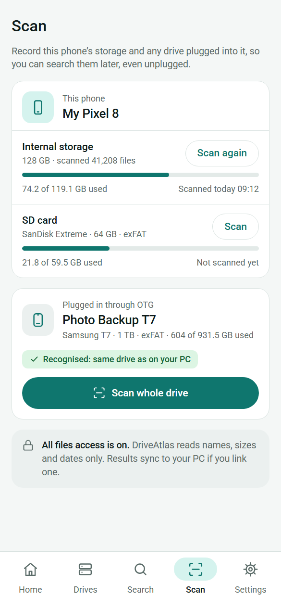</picture><p align="center"><sub>This phone and OTG drives</sub></p></td>
</tr>
</table>

## How it works

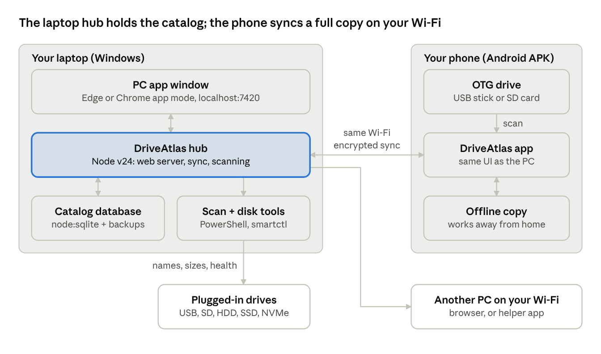

- **Hub on your PC.** A small Node.js process holds the catalog in a SQLite file, reads drive details through PowerShell and `smartctl`, and serves the app to this PC only (from Phase 2, also to your paired phone on your home network).
- **App window on Windows.** The interface opens in its own Edge or Chrome app window, pinned to the Start menu. No browser tabs, no installer bloat.
- **Android app.** The same interface packaged as an APK. It works on its own with its own catalog, or links to your PC with one QR scan; then both keep the whole catalog and sync both ways on the same Wi-Fi.
- **Backups.** One encrypted backup file holds everything. Restore it on a new laptop and DriveAtlas comes back exactly as it was.

## Roadmap

| Phase | What ships | Status |
| --- | --- | --- |
| 0 · Design | Product and screen design for Windows and Android | Done |
| 1 · PC app | Hub, drive catalog, plug-in and change detection, scanning, file browser, search, partitions, health, backup and restore | Done |
| 2 · Android, helpers and sync | Android app on its own or with a PC: catalog on the phone, phone storage and OTG scanning, fingerprint or PIN, QR linking, two-way sync, APKs on GitHub Releases, then helper PCs | In progress |
| 3 · Organize and insights | Locations and lent-out, QR labels, reminders, duplicates, scan history, charts, exports | Planned |

## Tech stack

| Part | Choice |
| --- | --- |
| Hub | Node.js 24 built-ins only: `node:http`, `node:sqlite` with full-text search, `node:crypto`, worker threads |
| Drive data | PowerShell storage cmdlets, `smartctl` from smartmontools |
| Interface | Preact + htm, plain CSS design tokens, hand-drawn SVG charts |
| Windows shell | Edge/Chrome app window, Start menu and Startup shortcuts |
| Android | Capacitor, SQLite, Storage Access Framework for OTG, ML Kit QR scanner |
| Builds | GitHub Actions builds and signs the APK |

## Getting started

The PC app is complete: account, drive catalog, plug-in and change detection, background scanning (with photo and video details and quick fingerprints), a file browser that works offline, search across every drive, drive health, encrypted backups and restore. The Android app comes next.

**You will need:** Windows 10 or 11, [Node.js](https://nodejs.org) 22 or newer, and Microsoft Edge or Google Chrome. Nothing else to install.

1. Download or clone this repository.
2. Double-click **`DriveAtlas.vbs`**. DriveAtlas opens in its own window.
3. Create your account, then add the drives listed under **Connected now**. Their details are filled in for you.
4. Open a drive and choose **Scan now**. Afterwards, search its files from **Search**, even when the drive is unplugged.
5. In **Settings**, choose a backup folder (ideally on another drive or a cloud folder) and turn on daily backups. **Read health now** shows wear and temperature after you approve the Windows prompt; install the free smartmontools from the same card for full details.
6. Optional: add DriveAtlas to the Start menu (no admin needed):

   ```bash
   powershell -ExecutionPolicy Bypass -File app/scripts/install.ps1
   ```

   Add `-Startup` to start the hub when you sign in, or `-Uninstall` to remove the shortcuts.

Your catalog lives in `%LOCALAPPDATA%\DriveAtlas\data`, outside this folder, so updating the app never touches it. `DriveAtlas.cmd` starts the same app with a visible log window for troubleshooting.

## Project structure

```
DriveAtlas/
├── DriveAtlas.vbs             Double-click to start (no console window)
├── DriveAtlas.cmd             Same, with a visible log window for troubleshooting
├── app/
│   ├── hub/                   Node.js hub: web server, catalog database, drive detection, backups
│   │   ├── ps/                PowerShell scripts that read disks and drive health (read-only)
│   │   └── scan/              Background scanner
│   ├── ui/                    The interface (Preact + htm, plain CSS)
│   ├── shared/                Drive types and formatting used by hub and interface
│   ├── assets/                App icon
│   └── scripts/install.ps1    Optional Start menu and Startup shortcuts
├── LICENSE.md
└── README.md
```

## Privacy

DriveAtlas never uploads anything anywhere. It reads file names, folder structure, sizes and dates, plus the first few kilobytes of photos and videos for their details and fingerprints. It never copies, moves or changes your files. Sync happens only between your own devices on your own Wi-Fi, encrypted with a key shared by QR code.

## Security

The hub only listens on this PC and every catalog route needs your password-protected session. Backups are encrypted with your password, inputs are checked on the server, and requests from other websites are refused. If you find a security problem, please write to the author at the email address on [github.com/Sulman-Ahmad](https://github.com/Sulman-Ahmad) instead of opening a public issue.

## License

DriveAtlas is free for **personal use**. Modifying it, redistributing it, publishing or showcasing a modified version, or using it commercially requires written permission from the author first. Talking about it, reviewing it and linking to this repository is welcome. See [LICENSE.md](LICENSE.md) for the full terms.

## Author

Made by **Sulman Ahmad** · [github.com/Sulman-Ahmad](https://github.com/Sulman-Ahmad)
